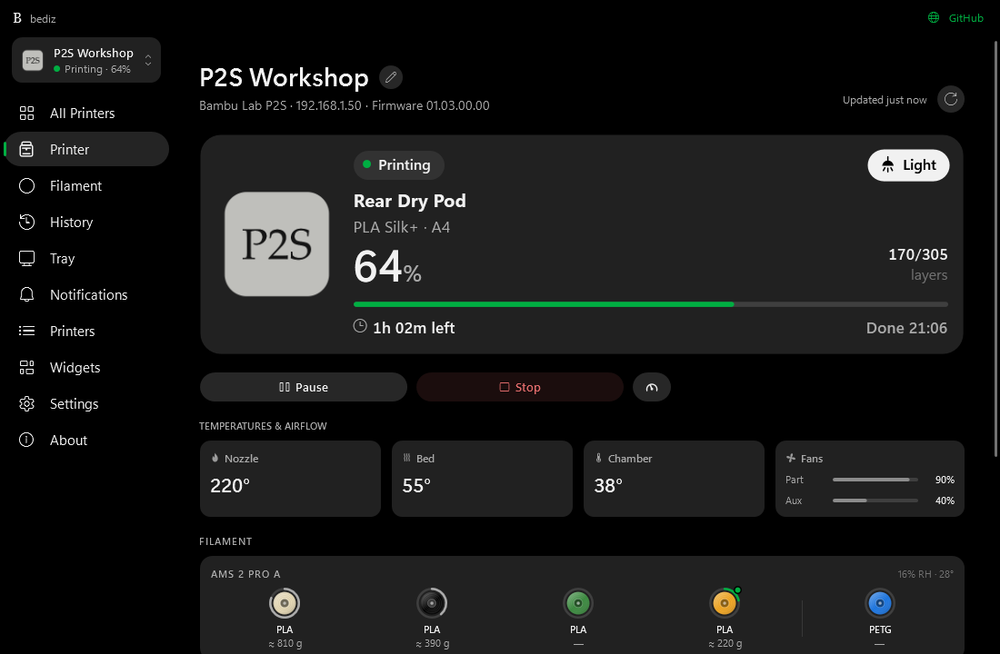
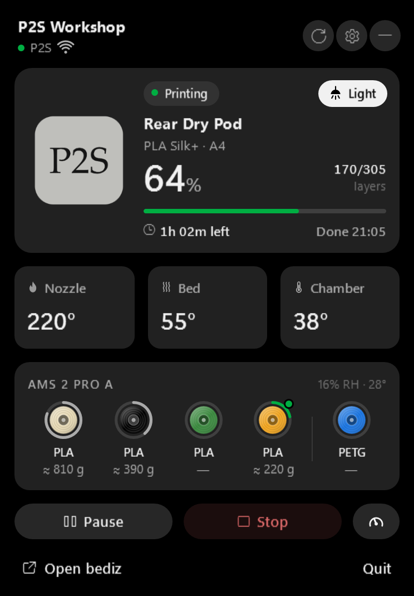
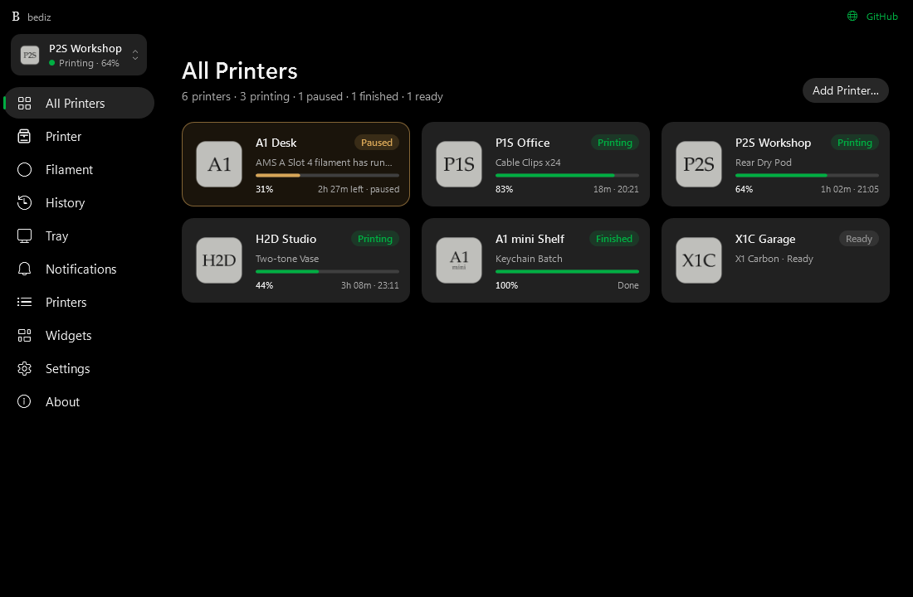

```powershell
$ProgressPreference = 'SilentlyContinue'; $a = (irm https://api.github.com/repos/yigitozsoy/bediz_takip/releases/latest).assets | ? name -like '*x64.exe' | select -First 1; irm $a.browser_download_url -OutFile "$env:TEMP\$($a.name)"; & "$env:TEMP\$($a.name)"
```

<sub>PowerShell'e yapıştırın: son sürümü indirip kurulumu açar (ARM bilgisayarlarda `*arm64.exe` yazın). Elle indirmek için [Releases](../../releases/latest).</sub>

<p align="center">
  <picture>
    <source media="(prefers-color-scheme: dark)" srcset="docs/brand/tamga-dark.png">
    
  </picture>
  &nbsp;&nbsp;&nbsp;&nbsp;&nbsp;
  <picture>
    <source media="(prefers-color-scheme: dark)" srcset="docs/brand/bediz-dark.png">
    
  </picture>
</p>

<h1 align="center">bediz</h1>

<p align="center">
  Bambu Lab 3D yazıcınızın ilerlemesi, sıcaklıkları ve filamenti görev çubuğunda, tek tık uzağınızda.<br>
  <sub>tamga ailesinden · Windows 10 / 11 (x64, ARM64)</sub>
</p>

## Özellikler

- **Görev çubuğunda yazıcı.** Simge baskıyla dolar; yüzde ve kalan süre bir bakışta, yazıcı sizi beklerken işaret çıkar.
- **Tek tıkla panel.** İş, aşama, katman, bitiş saati; nozul, tabla ve hazne sıcaklıkları; AMS makaraları gram ve nemle.
- **Kontroller.** Duraklat, devam, durdur, baskı hızı ve hazne ışığı (yazıcıda LAN Only + Developer Mode gerekir).
- **Canlı kamera.** Panelde ya da üstte kalabilen ayrı pencerede (varsayılan kapalı).
- **Birden çok yazıcı.** Hepsini aynı anda izler; sizi bekleyenler en üstte.
- **Bildirimler.** Baskı bitti, durdu, filament bitti, yeni hata; isteğe bağlı Discord / Telegram'a da.
- **Masaüstü widget'ları.** Küçük, orta, büyük; Rainmeter kurulumla birlikte gelir.
- **Kolay kurulum.** Ağdaki yazıcıları bulur, erişim kodunu Bambu Studio / OrcaSlicer'dan kendisi okur.
- **Anlaşılır hatalar.** Yazıcı hataları Bambu Lab'ın kendi metinleriyle, kodu ve wiki bağlantısıyla.
- **Yerel ve sade.** Veriler yerel ağda kalır, kullanım verisi toplanmaz; tamga ailesiyle aynı 10 tema ve vurgu renkleri.

Desteklenen yazıcılar: P2S, P1S, P1P, X1 / X1 Carbon / X1E, X2D, A1, A1 mini, A2L, H2D / H2D Pro / H2C / H2S, H3C.

## Görseller

<p align="center"></p>
<p align="center">
  
  
</p>

## Lisans

[MIT](LICENSE). bediz, NINA LABS'in [Bambu Bar](https://github.com/rolottr/bambu-bar) uygulamasının (© 2026 NINA LABS, LLC,
MIT) Yiğit Özsoy tarafından Windows için uyarlanmış çatallamasıdır; depoda özgün macOS kodu da durur. Protokol ayrıntıları
ve hata metinleri [ha-bambulab](https://github.com/greghesp/ha-bambulab) (MIT) projesinden; widget'lar
[Rainmeter](https://www.rainmeter.net) (GPL-2.0) ile çizilir, kamera görüntüsü [FFmpeg](https://ffmpeg.org/) ile çözülür.
Bambu Lab, Bambu Studio ve AMS, Bambu Lab'ın ticari markalarıdır; bu proje Bambu Lab ile bağlantılı değildir.
